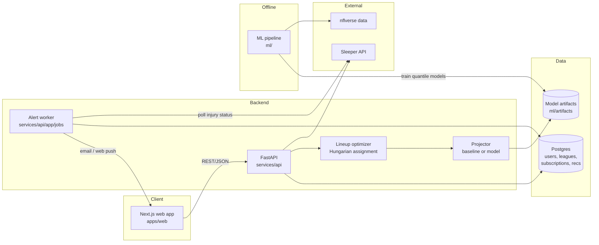

# Architecture

## Goals

1. **League-aware**: read a user's real roster and scoring settings (Sleeper first) and build their optimal lineup.
2. **Big swing**: every projection is a *distribution* (floor / median / ceiling), and a risk slider decides how much of it to chase.
3. **Live alerts**: on game days, detect inactive/questionable starters and suggest the best swap before kickoff.
4. **Accountable**: log every recommendation and grade it after the week (later: public accuracy scoreboard).

## System diagram



## Components

| Component | Path | Responsibility |
|---|---|---|
| Web app | `apps/web` | Username → league picker → lineup view with risk slider, alert opt-in |
| API | `services/api` | League sync, projections, optimization, alert subscriptions |
| Sleeper client | `services/api/app/clients/sleeper.py` | Typed, cached wrapper over the public read-only Sleeper API |
| Projector | `services/api/app/services/projections.py` | Returns `(floor, median, ceiling)` per player per week. `BaselineProjector` today, `ModelProjector` once trained |
| Optimizer | `services/api/app/services/optimizer.py` | Maps the league's `roster_positions` to slots and solves the optimal assignment |
| Alert worker | `services/api/app/jobs/inactive_watch.py` | Game-day poll → diff starters' injury status → notify with best swap |
| ML pipeline | `ml/` | nflverse ingest → features → LightGBM quantile models (p10/p50/p90) → artifact |

## Key design decisions

### Projections are quantiles, not points
Each player gets `p10` (floor), `p50` (median) and `p90` (ceiling). We train three gradient-boosted
models with quantile loss rather than one point model. This is what powers the risk slider, and it's
easy to evaluate honestly (calibration: ~80% of outcomes should land between p10 and p90).

### The risk slider
`risk ∈ [-1, 1]` (−1 = safest, 0 = median, +1 = biggest swing):

```
score(r) = p50 + r · (p90 − p50)   if r ≥ 0
score(r) = p50 + r · (p50 − p10)   if r < 0
```

At `r = +1` you rank by ceiling (use it when you're the underdog). At `r = −1` you rank by floor
(use it when you're favored). A future version can auto-suggest `r` from the matchup's win probability.

### Optimal lineups via assignment, not greedy
Greedy fill ("best QB, best RB…, then FLEX") can be wrong when a player is eligible for several slots.
We build a `players × slots` score matrix (ineligible = large negative) and solve it with
`scipy.optimize.linear_sum_assignment`. It's optimal, fast and handles FLEX / SUPER_FLEX / REC_FLEX
for free.

### Sleeper first, providers behind an interface
Sleeper is public and needs no auth, so it ships first. Yahoo (OAuth) and ESPN (cookies) can plug in later
behind the same `LeagueProvider` shape (`get_user`, `get_leagues`, `get_rosters`, `get_league`).

### Caching
`/players/nfl` is ~5 MB and Sleeper asks clients to fetch it at most once a day, so it's cached in-process
(Redis later) with a 24 h TTL. League and roster calls are cached for 60 s.

### Alerts
- Runs every 15 min on Sundays 9:00–13:00 ET (plus TNF/MNF windows) via cron, GitHub Actions or Railway cron.
- Compares each subscribed roster's **starters** against Sleeper `injury_status` (`Out`, `Doubtful`, `IR`, `Questionable`).
- Each alert is deduped by `(league, player, status, week)` so it's sent once.
- The suggested swap is the best eligible bench player for that slot, using the user's saved risk level.

## API surface (v1)

| Method | Route | Purpose |
|---|---|---|
| GET | `/health` | Liveness |
| GET | `/v1/users/{username}/leagues?season=` | Resolve Sleeper user → leagues |
| GET | `/v1/leagues/{league_id}/rosters/{owner_id}` | Roster with player names/positions/status |
| GET | `/v1/leagues/{league_id}/lineup?owner_id=&week=&risk=` | Optimal lineup + bench + start/sit deltas |
| POST | `/v1/alerts/subscriptions` | Opt a roster into game-day alerts |
| DELETE | `/v1/alerts/subscriptions/{id}` | Opt out |

## Tech stack

- **Frontend**: Next.js (App Router) + TypeScript + plain CSS (design tokens in `globals.css`), deployed on Vercel
- **API**: Python 3.12+, FastAPI, httpx, pydantic, scipy, deployed on Railway / Fly.io / Render
- **ML**: pandas, nflreadpy (nflverse), LightGBM, scikit-learn
- **DB**: Postgres (SQLite in dev)
- **CI**: GitHub Actions (pytest, ruff, `next build`)
